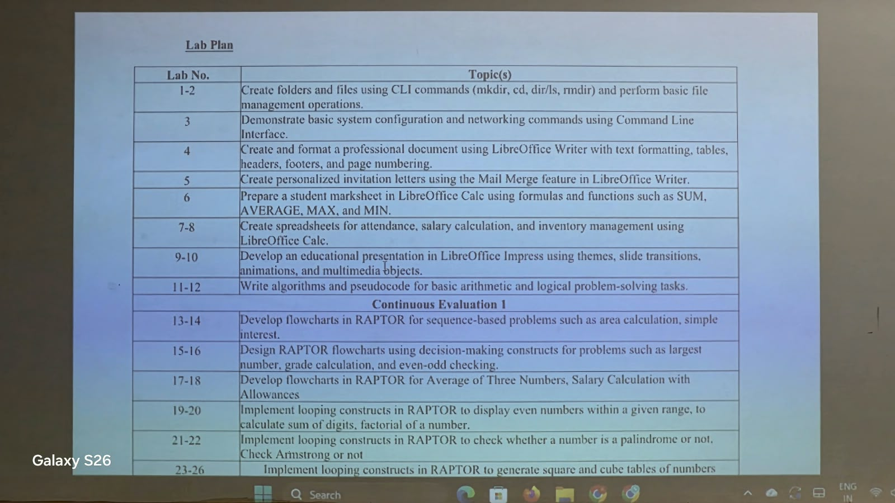

# BCPS

Basics of Computer Science and Problem Solving — practical work for **labs 1–10**.

## Lab Plan



| Lab | Topic | Open this folder |
| --- | --- | --- |
| 1–2 | Command-line folders, files and file management | [lab-01-02](lab-01-02/) |
| 3 | System information and networking commands | [lab-03](lab-03/) |
| 4 | Writer formatting, tables, headers, footers and page numbers | [lab-04](lab-04/) |
| 5 | Personalized invitations using Writer mail merge | [lab-05](lab-05/) |
| 6 | Calc marksheet: SUM, AVERAGE, MAX and MIN | [lab-06](lab-06/) |
| 7–8 | Calc attendance, salary and inventory | [lab-07-08](lab-07-08/) |
| 9–10 | Educational Impress presentation | [lab-09-10](lab-09-10/) |

## How to use

1. Download or clone this repository.
2. Open each lab's README for its aim, procedure and examples.
3. Open `.odt` files in LibreOffice Writer, `.ods` files in Calc and `.odp` files in Impress.
4. Use Bash on Linux for `.sh` examples. Windows Command Prompt alternatives are included where relevant.

All student, employee and invitation records are fictional practice data. Salary rates are classroom assumptions. Replace any student-detail placeholders with your own details before submitting.

## Quick checks

```bash
bash lab-01-02/file-management.sh
python3 lab-07-08/check_workbooks.py
```

The file-management exercise creates a fresh temporary folder for each run. It does not modify existing coursework.

## References

- [GNU Coreutils manual](https://www.gnu.org/software/coreutils/manual/coreutils.html)
- [Windows command reference](https://learn.microsoft.com/en-us/windows-server/administration/windows-commands/windows-commands)
- [LibreOffice help](https://help.libreoffice.org/latest/en-US/)
- [Writer Mail Merge Wizard](https://help.libreoffice.org/latest/en-US/text/swriter/01/mailmerge00.html)
